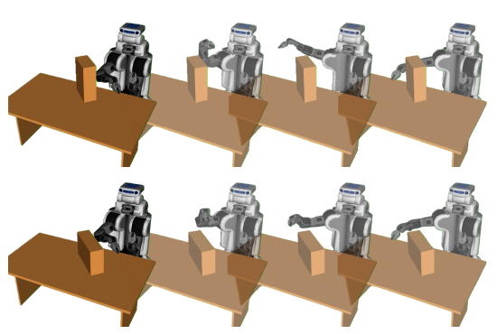

<section class="hero">
  

    
Autonomy · Robotics · AI mission planning

    <h1>Building autonomy for the <em>real world.</em></h1>
    
I’m Jaein Lim, an autonomy engineer and researcher. I develop algorithms that help robots plan, coordinate, and act—and bring them from research to simulation, vehicle integration, and flight testing.

    
<a class="button" href="/projects/">Explore my work <svg class="out-arrow" aria-hidden="true" viewBox="0 0 16 16" fill="none"><path d="M3 13 13 3M3 3h10v10" stroke="currentColor" stroke-width="1.3"/></svg></a><a class="text-link" href="/cv/">View résumé <svg class="out-arrow" aria-hidden="true" viewBox="0 0 16 16" fill="none"><path d="M3 13 13 3M3 3h10v10" stroke="currentColor" stroke-width="1.3"/></svg></a>

    
<strong>Senior Member of Technical Staff, Draper</strong> Autonomy and Real-time Planning · Cambridge, MA

  

  <figure class="portrait"><figcaption>JAEIN LIM, PH.D.CAMBRIDGE, MA</figcaption></figure>
</section>

<strong>Draper</strong>Autonomy & real-time planning September 2022–present

<strong>Georgia Tech</strong>Ph.D. in Aerospace Engineering August 2022

<strong>3 / 6</strong>Coordinated vehicles Flight tests / simulation

<section class="section">
 

01 / Research & engineering
<h2>Planning. Coordination. Action.</h2>

 

  <article class="focus-item">
01 — MULTI-AGENT SYSTEMS
<h3>Helping robots work together.</h3>
Decentralized path deconfliction, multi-agent pathfinding, and task allocation. Connecting theoretical guarantees with coordination on real vehicles.

MAPLECBS-BudgetMulti-robot planning
</article>
  <article class="focus-item">
02 — AI MISSION PLANNING
<h3>From operator intent to robot action.</h3>
Context-aware AI agents that reason about mission objectives and vehicle capabilities, with execution tools and interfaces to autonomy systems.

vLLMGraph-RAGMCP
</article>
  <article class="focus-item">
03 — AUTONOMY ENGINEERING
<h3>Algorithms that leave the lab.</h3>
Motion planning, controller interfaces, and automated testing across simulation and hardware. Experience spanning aerial, ground, undersea, and spacecraft autonomy.

C++ / PythonROS 2SITL / HITL
</article>
 

</section>
<section class="section">
 

02 / A closer look
<h2>Search smarter. Replan faster.</h2>
<a class="text-link" href="/projects/">All work <svg class="out-arrow" aria-hidden="true" viewBox="0 0 16 16" fill="none"><path d="M3 13 13 3M3 3h10v10" stroke="currentColor" stroke-width="1.3"/></svg></a>

 <article class="work-feature">

Motion planning / Heuristic search
<h3>Spend computation where it matters.</h3>
My research combines lazy evaluation with incremental search: reuse what a planner already knows, and avoid expensive edge evaluations that do not help find a solution.

The result is a family of efficient replanning algorithms, including methods with bounded-suboptimality guarantees.
<a class="text-link" href="/projects/lis">Explore lazy incremental search <svg class="out-arrow" aria-hidden="true" viewBox="0 0 16 16" fill="none"><path d="M3 13 13 3M3 3h10v10" stroke="currentColor" stroke-width="1.3"/></svg></a>

RESEARCH VISUALIZATION · LAZY INCREMENTAL SEARCH

</article>
</section>
<section class="section">
 

03 / Selected publications
<h2>Ideas, in print.</h2>
<a class="text-link" href="/publications/">All publications <svg class="out-arrow" aria-hidden="true" viewBox="0 0 16 16" fill="none"><path d="M3 13 13 3M3 3h10v10" stroke="currentColor" stroke-width="1.3"/></svg></a>

 
</section>
<section class="contact-band">

Let’s connect
<h2>Interested in autonomy and multi-robot systems?</h2>
I’m happy to connect with researchers and engineers working in the field.

<a class="button" href="mailto:jliminf@gmail.com">Get in touch <svg class="out-arrow" aria-hidden="true" viewBox="0 0 16 16" fill="none"><path d="M3 13 13 3M3 3h10v10" stroke="currentColor" stroke-width="1.3"/></svg></a></section>
