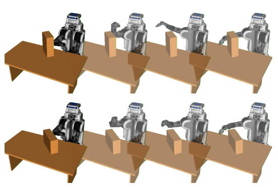
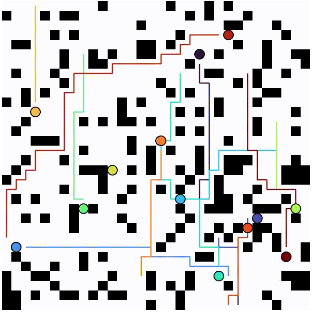
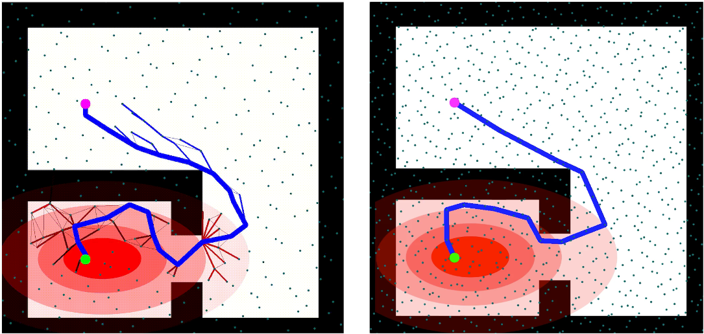
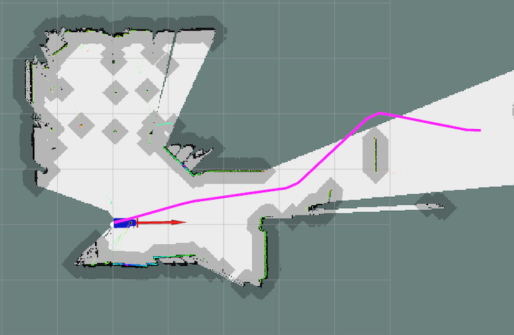
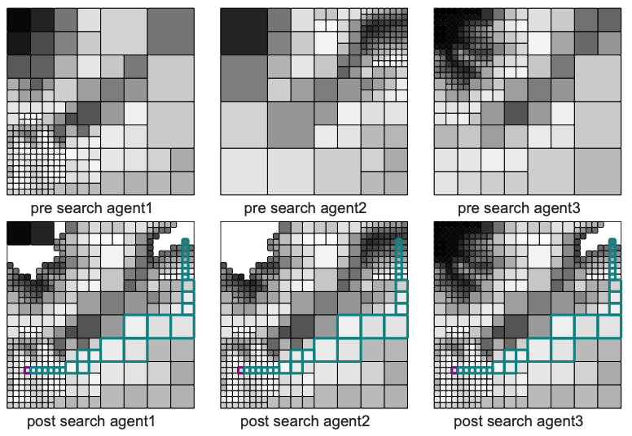

<article class="focus-item">
DRAPER / AI MISSION PLANNING
<h3>Context-aware AI agents</h3>
Lead development of an agent and execution harness that connect operator intent, vehicle capabilities, graph-based retrieval, and vehicle-specific tools.

vLLMGraph-RAGMCP
</article><article class="focus-item">
DRAPER / MULTI-AGENT AUTONOMY
<h3>Decentralized deconfliction</h3>
Led MAPLE development for asynchronous UAV path deconfliction on CSIRP, validated with up to 3 coordinated vehicles in flight tests and 6 in simulation.

MAPLEVehicle integration
</article><article class="focus-item">
DRAPER / INTEGRATION & TESTING
<h3>From simulation to flight</h3>
Controller interfaces, third-party vehicle integration, and automated testing across software, simulation, hardware, and processor-in-the-loop systems.

DockerPX4ArduPilot
</article>

<h2>Research projects</h2>

<article class="project-card"><h2><a href="/projects/lis">Lazy incremental search <svg class="out-arrow" aria-hidden="true" viewBox="0 0 16 16" fill="none"><path d="M3 13 13 3M3 3h10v10" stroke="currentColor" stroke-width="1.3"/></svg></a></h2>
Reuse previous search results and limit expensive edge evaluations for efficient replanning with bounded-suboptimality guarantees.
</article><article class="project-card"><h2><a href="/projects/mapf">Multi-agent pathfinding <svg class="out-arrow" aria-hidden="true" viewBox="0 0 16 16" fill="none"><path d="M3 13 13 3M3 3h10v10" stroke="currentColor" stroke-width="1.3"/></svg></a></h2>
CBS-Budget and heuristic search methods for coordinating collision-free paths across robot teams.
</article><article class="project-card"><h2><a href="/projects/semantic_planning">Semantic-geometric planning <svg class="out-arrow" aria-hidden="true" viewBox="0 0 16 16" fill="none"><path d="M3 13 13 3M3 3h10v10" stroke="currentColor" stroke-width="1.3"/></svg></a></h2>
Generalized heuristic search in weighted colored graphs, combining geometric decisions with semantic preferences.
</article><article class="project-card"><h2><a href="/projects/stack">Autonomous navigation <svg class="out-arrow" aria-hidden="true" viewBox="0 0 16 16" fill="none"><path d="M3 13 13 3M3 3h10v10" stroke="currentColor" stroke-width="1.3"/></svg></a></h2>
A ROS planning stack and OMPL interface for a robotic car with stereo vision, inertial sensing, and LiDAR.
</article><article class="project-card"><h2><a href="/projects/mams">Collaborative search <svg class="out-arrow" aria-hidden="true" viewBox="0 0 16 16" fill="none"><path d="M3 13 13 3M3 3h10v10" stroke="currentColor" stroke-width="1.3"/></svg></a></h2>
Multi-agent, multi-scale planning for cooperative robot teams.
</article>

